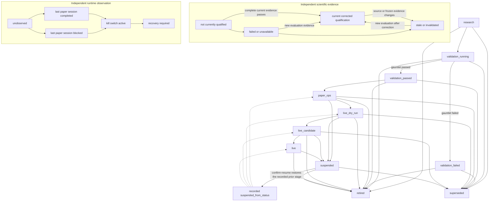

# Experiment lifecycle state machine

The persisted `Experiment.promotion_status` and the transition matrix in
`experiments.models` remain the promotion source of truth. The registry
assessment is read-only: it combines the current promotion stage with separate
scientific and runtime observations. It never writes a status, grants trading
authority, or treats a stage label as evidence that its gates passed.



The solid edges in the top diagram are existing transitions enforced by
`is_legal_promotion_transition` and `ExperimentRegistry`. The dashed edges are
the possible saved destinations; one is selected from the Experiment's
`suspended_from_status`. The lower axes are assessment categories, not persisted
transition machines; a new read simply reflects the current evidence and switch
state.

The scientific axis comes from `check_current_qualification`, which verifies
the frozen Experiment and corrected evaluation provenance. `PASS` means
numerical qualification only; paper operations, financial parity, broker
qualification, and operator approval remain distinct gates. The runtime axis
reads the active Experiment kill switch and immutable paper-session records. A
completed paper session reports only that session's execution outcome; it is not
a claim of current runtime health, scientific qualification, or paper-ops
promotion.

## Existing transition and evidence rules

- `research` enters `validation_running`; validation ends in `validation_passed`
  or terminal `validation_failed`. A failed Experiment is not resumed; a new
  hypothesis requires a new Experiment.
- Advancement from `validation_passed` to `paper_ops` is guarded by current
  corrected numerical qualification in `ExperimentRegistry`.
- `paper_ops` to `live_dry_run` uses the operator-confirmation path and requires
  current qualification plus actual paper-session evidence. Existing paper
  operations thresholds and prerequisites remain unchanged.
- The registry transition matrix includes `live_dry_run`, `live_candidate`, and
  `live`, but this assessment adds no deployment workflow and does not supply
  missing live readiness evidence or manual authorization.
- A hard or catastrophic kill suspends the Experiment and captures its prior
  stage. Clearing a switch does not resume it; `confirm-resume` is the explicit
  recovery action. A soft kill blocks runtime orders without changing the
  promotion stage.
- `retired` and `superseded` are terminal. Order state, order reconciliation,
  and portfolio state remain their existing independent execution axes.

`ExperimentRegistry.inspect_lifecycle(uuid)` returns the persisted promotion
status, the live corrected-qualification result, and the latest paper runtime
observation as three separate fields. Runtime observations deliberately use
`unobserved`, `last_session_completed`, `last_session_blocked`, `stale_session`,
`invalid_evidence`, `kill_switch_active`, and `recovery_required`; there is no
`ready_to_trade` result. This is a read model, not a transition API.

For terminal-friendly inspection, use the read-only CLI command:

```sh
mfs-engine experiment-status \
  --experiment-root /path/to/experiments \
  --experiment-uuid <uuid>
```

It prints the stored promotion stage, numerical qualification and reason, last
runtime evidence, and blockers observed on those axes. The blocker list is not
a complete readiness checklist. The report never authorizes trading or changes
the Experiment.
